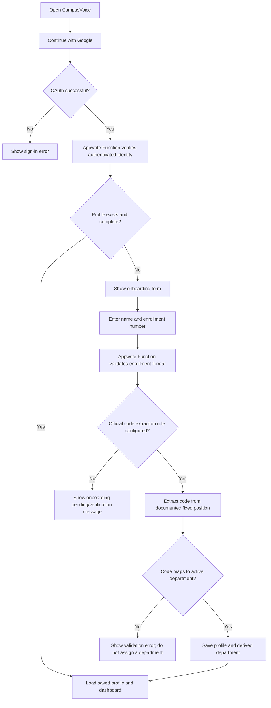

# CampusVoice — Application Flow

## 1. Student Sign-in and First Login

**Important:** The department-code position is confirmed as characters 8–9 (1-based indexing). Extract only that substring; never search the entire enrollment number for `06`/`07`. Validate the remaining enrollment format against official examples before production.

## 2. Student Complaint Submission
1. Student opens the community dashboard.
2. Frontend invokes the appropriate Appwrite Function to request a paginated list.
3. The Function verifies the student's identity and loads their saved department.
4. The Function returns that department's complaints plus all Public Issues.
5. Student selects “Create complaint”.
6. The Raise Complaint form pre-fills student name, enrollment number, and department from the saved profile; all three fields are read-only.
7. Student enters complaint title, location, description, selects priority (Low/Medium/High), optionally attaches a file, and selects issue type.
8. The frontend validates required fields and shows clear errors; the Appwrite Function repeats validation and derives identity/department from the authenticated student's trusted profile.
7. The Function validates the fields and determines ownership from the authenticated profile.
9. For a department issue, the Function assigns the student's department; it does not trust a client-supplied department ID or profile values.
9. For a public issue, the Function stores the public issue type and applies public visibility.
10. The new complaint appears in the relevant feed.

## 3. Supporting a Complaint
1. Student opens a complaint card.
2. UI shows whether the current student has supported it.
3. Student clicks **Support**.
4. The Function checks authentication, profile completion, complaint visibility, and eligibility.
5. The Function creates a support record using a uniqueness strategy supported by the selected Appwrite Database version.
6. If a support record already exists, the Function returns a controlled “already supported” response.
7. UI refreshes the supporter count from the server.
8. No new complaint record is created.

## 4. Admin Flow
1. Admin signs in through Google OAuth.
2. The Function verifies the authenticated identity.
3. The Function checks the server-managed admin allowlist/profile and assigned department.
4. If not authorized, return 403 and do not expose admin data.
5. Authorized admin sees their department's private complaints and all Public Issues.
6. Admin opens a complaint, reviews details/support count, and selects a status.
7. The Function checks admin role and scope again.
8. The Function updates status and optional administrative response.
9. Student feeds display the updated status.

## 5. Visibility Rules
| Resource | Student in Dept A | Student in Dept B | Admin A | Admin B |
|---|---|---|---|---|
| Department A complaint | View/support | No access | View/manage | No access |
| Department B complaint | No access | View/support | No access | View/manage |
| Public Issue | View/support | View/support | View/manage | View/manage |

## 6. Error and Empty States
- OAuth cancelled or failed: explain that sign-in did not complete and provide retry.
- Incomplete profile: direct the user to onboarding.
- Unknown enrollment code or unconfigured code position: do not assign a department; show a clear pending/verification message.
- Duplicate support: explain that the student already supports the complaint and show the current count.
- Unauthorized admin route/API: show access denied without leaking private records.
- Empty feed: explain that no complaints currently match the filters.
- Network/API failure: show retry controls and do not pretend a mutation succeeded.
- Validation failure: show field-specific feedback.

## 7. Open Flow Decisions
- Whether support can be withdrawn is deferred.
- Whether a student can submit a Public Issue directly or only when the problem is college-wide needs a product rule; initial MVP permits choosing Public Issue but should include a short explanation.
- Admin email addresses and official enrollment format must be supplied before production configuration.

## First-time profile setup: permanent identity fields

On first login, ask the student to enter their name and enrollment number. Show this small note below the fields before saving:

> **Important:** Please check your name and enrollment number carefully. Once you save them, they cannot be changed through your account.

After saving, show both fields as read-only in the profile and complaint form. Corrections require an approved admin/support process.

Reference example from the screenshot: Student Name **Rahul**, Enrollment Number **246510307054**. These are example values only and must not be hard-coded for every student.
