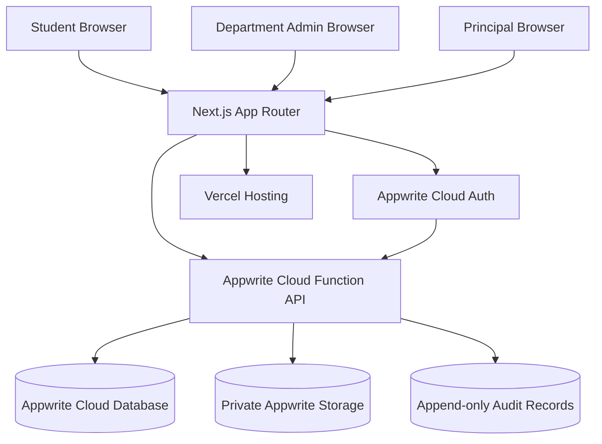

# CampusVoice — Architecture Specification (Updated)

**Version:** 2.0.0 | **Date:** 10 November 2026 | **Status:** Current target architecture

## Authoritative product rules (effective 10 November 2026)

### Stack
- Frontend: Next.js App Router + TypeScript.
- Authentication: Appwrite Cloud Auth with Google OAuth.
- Database: Appwrite Cloud Database.
- Backend: Appwrite Cloud Functions only.
- Frontend hosting: Vercel.
- Design source: Stitch MCP.
- Do not introduce FastAPI, another backend service, or a Super Admin role.

### Departments and jurisdiction
Six departments exist:
1. Computer
2. Civil
3. Electrical
4. Mechanical
5. Water
6. Sanitation

Computer, Civil, Electrical, and Mechanical are academic and maintenance departments. Water and Sanitation are maintenance-only.

Keep separate identifiers:
- `student_department_id`: the student's academic department and peer-visibility jurisdiction.
- `maintenance_department_id`: the department responsible for resolving a complaint.

Enrollment department code is extracted only from characters 8–9 using `enrollment_no[7:9]` (zero-based slice `[7:9]`). Known code mappings are `06` → Department 1 and `07` → Department 2. Official names/mappings for those codes and all remaining codes must be confirmed against institutional records before configuration. Never infer or invent mappings. Unmapped codes are rejected or routed to a controlled pending-verification state without assigning a department.

### Roles and permissions
Exactly three main roles: Student, Department Admin, Principal. Selected existing accounts may receive explicit additional system-management permission grants; grants must be server-enforced, auditable, and revocable. No Super Admin role.

Department Admin has a scoped assignment. Maintenance Admin manages complaints routed to their maintenance department. A student's academic Department Admin handles that student's phone-change request. Water and Sanitation Admins cannot approve student phone changes.

Principal can monitor all six departments, view authorized complaint/student details, see metrics/history/delays, issue manual warnings on eligible unresolved complaints, review admin warning responses, manage departments/admin assignments/accounts/permissions/settings, and inspect audit/security history. Principal cannot change complaint status and cannot warn on resolved complaints.

### Student onboarding and phone profile
First login collects student name, enrollment number, and phone number. Name and enrollment number lock after saving. Phone number locks after saving except through the approved phone-change workflow. Phone validation is exactly 10 digits and begins with 6, 7, 8, or 9. Validate server-side. Format validation does not establish ownership.

Phone-change workflow: student requests change through their own academic Department Admin; admin approves/rejects; approval grants a one-time update permission; old number remains active until successful save; permission is consumed only after successful database save; invalid input, network failure, or database failure must not consume permission; audit request, decision, and outcome.

### Complaints
A student can file a complaint to any of the six maintenance departments. Fields: title, maintenance department, location, description, priority (Low/Medium/High), optional attachment. Attachment max 5 MB; allowed PDF/JPG/JPEG/PNG only; verify actual file existence, ownership, MIME/type, size, and private access server-side. Public complaint functionality is removed completely.

Original complaint record is immutable after creation. Statuses are Pending, In Progress, Resolved. The concerned Maintenance Department Admin alone changes status. Admin official responses, substantive progress updates, clarification requests, and student replies are separate append-only timeline entries.

### Visibility and privacy
Students see complaints created by students from their own academic department, regardless of the selected maintenance department. Peer visibility is based only on `student_department_id`. The complaint's `maintenance_department_id` determines which Maintenance Admin manages it.

Peer students must not receive creator name, enrollment number, phone number, or private attachment references/URLs. Creator can see their own full complaint. Concerned Maintenance Admin and Principal can see full details within authorization. Never rely on frontend hiding; project sensitive fields out of backend responses.

### Support
Initial support count is 1 (creator baseline). Creator cannot support own complaint. Only same-academic-department students may support. One active support per student per complaint. Student may remove their support and support again later. Displayed count is `1 + active support records`; do not trust or increment a client-provided count. Prevent duplicate active records and handle concurrent requests safely.

### Delay and warnings
Pending complaints become warning-eligible after more than five days in Pending. In Progress complaints become eligible after more than five days since the last meaningful status change or substantive progress update. Minor edits, views, refreshes, and unrelated actions do not reset the timer. Resolved complaints are excluded. Principal issues manual warnings; multiple warnings may be issued while a complaint remains unresolved.

### Security and audit
Authenticate and authorize every protected backend operation. Derive identity, role, academic department, maintenance assignment, support count, and permissions from trusted server-side records. Protect against IDOR, privilege escalation, cross-department leakage, attachment access abuse, and secret exposure. Append-only audit history must cover complaint lifecycle, support add/remove, timeline/clarification, warnings/responses, phone-change workflow, admin assignments, role/permission changes, and settings changes. Normal users/admins cannot modify or delete audit history through application operations.

## 1. System context

## 2. Architectural boundaries
- Next.js is presentation and interaction only.
- Appwrite Auth establishes identity.
- Appwrite Cloud Functions are the sole trusted business-logic boundary.
- Appwrite Database stores profiles, departments, complaints, supports, timeline entries, phone-change requests, warnings, admin assignments/permission grants, and audit events.
- Appwrite Storage holds private complaint attachments.
- Vercel hosts the frontend only.

No separate backend service is permitted.

## 3. Identity and authorization
Every protected operation validates the authenticated caller, resolves the trusted profile, resolves current role/permission grants, and checks resource scope. Client-supplied IDs, role names, department IDs, permissions, and counters are never authoritative.

Department Admin assignments must distinguish:
- Maintenance assignment for complaint management.
- Academic department scope for student phone-change requests.

A Department Admin may hold one or more explicit scoped assignments if institutionally authorized. The exact assignment model must not blur the two scopes.

## 4. Complaint domain model
A complaint stores both `student_department_id` and `maintenance_department_id`. Student feed scope is the former; operational admin queue scope is the latter. Complaint's original content is immutable after creation. Mutable lifecycle events are append-only timeline records. If a cached current status is retained for query performance, it is a derived projection updated transactionally with the timeline event; it must not replace the authoritative event history.

## 5. Timeline model
Timeline entry types include:
- `status_change`
- `progress_update`
- `clarification_request`
- `clarification_reply`
- `admin_response`

Only authorized actors may append each event type. Status changes are permitted only to the concerned Maintenance Department Admin. Principal cannot change status.

## 6. Support model
One support identity per `(complaint_id, user_id)` with active/revoked state, or an equivalent safe model. Re-support after revocation must be possible without allowing duplicate active records. Count is derived from the creator baseline plus active support records. Use a transaction/atomic strategy supported by the selected Appwrite version; document and test its concurrency behavior.

## 7. Warning model
Warning eligibility is computed from authoritative complaint/timeline timestamps. Store `last_meaningful_update_at` as a projection only if its update is transactionally coupled to a meaningful event. Do not update it for views, refreshes, minor edits, or unrelated actions. Resolved complaints are never eligible.

## 8. Suggested logical collections
- `departments`
- `profiles`
- `complaints`
- `complaint_supports`
- `complaint_timeline`
- `phone_change_requests`
- `complaint_warnings`
- `department_admin_assignments` (or equivalent scoped grant model)
- `permission_grants` (if separate from assignments)
- `audit_logs`

Final collection shape and indexes must be validated against Appwrite Cloud's actual attribute/index limits before migration.

## 9. Appwrite permissions
Keep sensitive collections inaccessible to browser SDK direct reads/writes. Use Cloud Functions with least-privilege server credentials. Public department directory data may be exposed only through a controlled read operation. Private attachments must not have public read access. Do not assume that an empty ACL alone makes server-side logic append-only; enforce audit write policy in the backend and operational controls.

## 10. Failure handling
Mutations must be idempotent where practical. For multi-document workflows (status event + status projection + audit event; phone save + permission consumption + audit event), define atomicity/compensation behavior based on actual Appwrite transaction capabilities. If atomic commit is unavailable, design a recoverable state machine and reconciliation test rather than claiming atomicity.
