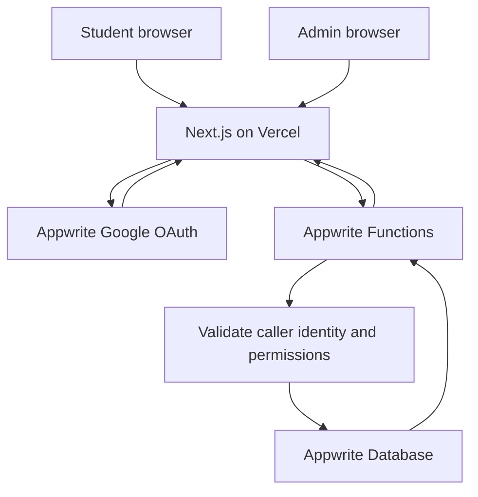

# CampusVoice — Architecture

## 1. Architecture Summary
CampusVoice uses a serverless architecture with no separately hosted FastAPI server.

1. **Frontend:** Next.js App Router + TypeScript, deployed to Vercel.
2. **Authentication:** Appwrite Cloud Auth with Google OAuth.
3. **Database:** Appwrite Cloud Database.
4. **Backend logic:** Appwrite Cloud Functions, invoked by the frontend through Appwrite's supported Functions SDK/API.
5. **Optional scheduled/event-driven work:** Appwrite Functions only if a later feature needs it; not required for the MVP.

## 2. High-Level Request Flow



## 3. Trust Boundaries
- The browser is untrusted. Never trust a role, department ID, supporter count, creator ID, or admin status supplied by the client.
- Appwrite authenticates the user. Each protected Function must validate the caller's identity using a supported Appwrite authentication/JWT mechanism and reject missing, invalid, expired, or revoked credentials.
- A Function must resolve the user's server-managed profile and authorization before returning protected data or making changes.
- Appwrite server API keys/secrets belong only in Function environment variables. Never expose server credentials in `NEXT_PUBLIC_*` variables.
- Use the least-privileged Appwrite API key scopes required by each Function.
- Appwrite collection/document permissions should be conservative. Do not make private department complaints publicly readable.
- Confirm the current Appwrite Functions SDK/runtime behavior for passing caller identity to Functions before implementation. Do not assume a Function automatically receives the browser's session context without configuring the supported mechanism.

## 4. Main Components

### Next.js frontend
- Sign-in and OAuth callback handling.
- First-login onboarding.
- Student dashboard and community feed.
- Complaint creation/detail views.
- Admin dashboard.
- Client-side validation for usability, with authoritative validation repeated inside Functions.
- Invokes Appwrite Functions for business operations.

### Appwrite Functions
Implement small, testable backend functions or a single API function with clear internal routing. For the MVP, the recommended logical operations are:
- `get-profile`
- `complete-onboarding`
- `list-complaints`
- `get-complaint`
- `create-complaint`
- `support-complaint`
- `get-admin-dashboard`
- `list-admin-complaints`
- `update-admin-complaint`

Every protected Function must verify the caller, load their profile, check permissions, validate input, and return a consistent response. Avoid trusting user IDs or roles in request payloads.

### Appwrite Cloud
- Google OAuth provider configuration.
- Authenticated user identity/session.
- Database collections for profiles, departments, complaints, and support records. Complaint creation uses the authenticated student's trusted profile for name, enrollment number, and department; these values are not accepted as authoritative client input.
- Function environment variables and server-side credentials.
- Collection/document permissions configured conservatively.

## 5. Recommended Folder and File Structure

```text
campusvoice/
├── frontend/
│   ├── app/
│   │   ├── (public)/
│   │   │   ├── page.tsx
│   │   │   └── sign-in/page.tsx
│   │   ├── (student)/
│   │   │   ├── onboarding/page.tsx
│   │   │   ├── dashboard/page.tsx
│   │   │   ├── complaints/new/page.tsx
│   │   │   ├── complaints/[id]/page.tsx
│   │   │   └── activity/page.tsx
│   │   ├── admin/
│   │   │   ├── page.tsx
│   │   │   └── complaints/[id]/page.tsx
│   │   ├── auth/callback/page.tsx
│   │   ├── layout.tsx
│   │   └── globals.css
│   ├── components/
│   │   ├── layout/
│   │   ├── complaints/
│   │   ├── forms/
│   │   └── ui/
│   ├── lib/
│   │   ├── appwrite/client.ts
│   │   ├── appwrite/auth.ts
│   │   ├── appwrite/functions.ts
│   │   ├── validation/
│   │   └── types/
│   ├── public/
│   ├── .env.example
│   └── package.json
├── functions/
│   ├── get-profile/
│   ├── complete-onboarding/
│   ├── list-complaints/
│   ├── get-complaint/
│   ├── create-complaint/
│   ├── support-complaint/
│   ├── get-admin-dashboard/
│   ├── list-admin-complaints/
│   └── update-admin-complaint/
├── docs/
│   ├── prd.md
│   ├── architecture.md
│   ├── appflow.md
│   ├── trd.md
│   ├── rules.md
│   ├── schema.md
│   ├── implementationplan.md
│   └── design.md
└── README.md
```

The exact function packaging may differ depending on the chosen Appwrite runtime. Functions may be grouped into fewer deployable functions if that fits Appwrite's supported execution model. Keep logical responsibilities separate even if they share one deployment package.

## 6. Data and Service Boundaries
- The frontend may use Appwrite Auth for Google OAuth.
- Business data operations go through Appwrite Functions so authorization and validation are centralized.
- Functions use server-side Appwrite SDK access only after verifying the caller's identity and authorization.
- Department assignment is stored in the trusted profile and is not accepted as an authoritative client-supplied field.
- Support count is derived from support records or a reliable transactional aggregate, never trusted from a request body.

## 7. Deployment
- Frontend: Vercel.
- Backend logic: Appwrite Cloud Functions.
- Auth/database: Appwrite Cloud.
- Configure exact development and production origins and OAuth redirect URLs in Appwrite.
- Use HTTPS in production and restrict allowed origins where supported.
- Configure Function runtime, environment variables, execution permissions, and required API key scopes.
- Add a simple health/status check appropriate to the Appwrite Functions deployment model.
- Test the deployed OAuth, database, Function invocation, and authorization flows.

## 8. Unresolved Architecture Decisions
- Exact Appwrite Function runtime/language and SDK versions.
- Exact supported mechanism to pass and verify the authenticated user's identity inside Function executions.
- Full enrollment-number length/format and official department names; department-code position is confirmed as characters 8–9 (1-based indexing).
- Final collection permissions and required Function API key scopes.
- Whether to deploy one API-style Function or multiple smaller Functions.

## Immutable student identity

First-time profile setup collects the student's name and enrollment number and warns that they cannot be changed through the student's account after saving. The UI is read-only afterward, and Appwrite Functions must enforce the restriction server-side. Legitimate corrections use an authorized workflow. `Rahul` and `246510307054` are examples from the reference screenshot, not universal defaults.
